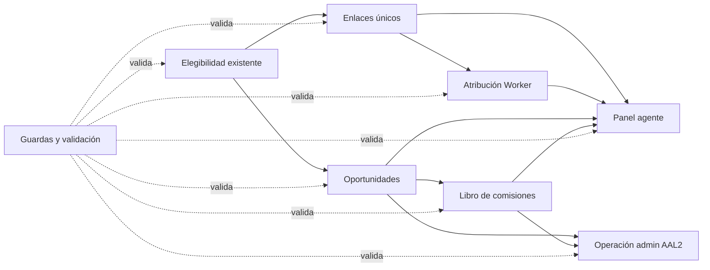

# Fase 3 — Plan de implementación local

Fecha: 2026-10-13  
Fuente de alcance: `D:\Proyectos\Cubitat\Propuesta_Cubitat_completa_cliente_actualizada.pdf` (junio 2026)  
Estado al 2026-11-02: el dueño definió reglas comerciales base para agentes, referidos, suscripciones CUP y comisión recurrente. La revisión técnica sigue como checkpoint DEV; no hay checkout/suscripciones implementados y B/C/E/G continúan bloqueados hasta construir y verificar sus contratos. Producción intacta.

## Decisiones de negocio — estado actualizado 2026-11-02

El dueño ya comunicó reglas base para selección de agentes, enlaces,
suscripciones y comisión recurrente. El registro del 2026-10-16 de abajo se
conserva como antecedente y queda parcialmente supersedido por esa decisión.
No reactivar los RPC existentes todavía: no hay sistema de pagos y el ledger
actual calcula comisiones manuales sobre oportunidades convertidas, mientras
la regla nueva requiere pagos confirmados de suscripciones. La propuesta y sus
decisiones abiertas están en `docs/FASE3_AGENTES_SUSCRIPCIONES_PROPUESTA.md`.

## Decisiones provisionales de lanzamiento — 2026-11-03

El dueño eligió promover la Fase 3 completa, con las funciones actuales gratis
por ahora: no aceptar cobros, no mostrar paywall y no bloquear acceso
automáticamente al vencer la prueba. La matriz gratuita/de pago final sigue
pendiente; esta regla solo permite preparar una primera salida segura sin
monetización.

Para postulaciones, el correo receptor es provisional
(`pochiprats18@gmail.com`); se aceptan PDF/JPG/PNG de hasta 10 MB y se borran 30
días después de la decisión final. El CV debe estar privado y el correo solo
llevará enlace firmado. El sistema no enviará CV reales hasta configurar el
destinatario y verificarlo en el entorno de release.

Se creó el candidato limpio `D:\cubitat-phase3-release` desde `origin/main`
(`d491419`), rama `feature/phase3-production-main`; contiene solo F3, aún sin
commit ni despliegue. La inspección de producción fue de solo lectura y no
encontró tablas/RPC F3. La reconciliación de migraciones sigue bloqueada por
colisiones e historial híbrido documentados en
`web/supabase/DATABASE_MIGRATIONS.md`; no ejecutar `db push` ni `migration
repair` mientras no se prepare una cadena canónica verificable.

## Bloqueo de definición de negocio — 2026-10-16 (histórico)

Los módulos B/C (enlace, visitas y atribución de referidos) y E/G (reglas y
operación de comisiones) quedan **pendientes de discutir con el dueño**. El
código y el prototipo desplegados en DEV no representan reglas comerciales
aprobadas. No ampliar flujos, cálculo, pantallas administrativas ni métricas de
estos dominios hasta registrar la decisión. La sesión con el dueño debe definir
al menos propósito del referido, qué cuenta como visita/consulta atribuible,
deduplicación, autorreferidos, elegibilidad y evidencia de conversión; para
comisiones, base elegible, tasa, moneda, responsables de aprobación, estados,
anulación y relación con un pago real. Al cerrar la discusión, actualizar esta
sección, OpenSpec y criterios de aceptación antes de retomar la implementación.

El registro de oportunidades consentidas (D) y la elegibilidad existente (A)
pueden probarse de forma independiente. Los paneles DEV siguen siendo un
prototipo técnico y producción no ha recibido estos módulos.

### Hallazgo de seguridad F3 — conteo de visitas de referido

La migración DEV `20261016120000_agent_referral_visit_tracking.sql` acepta
`p_visitor_key` del navegador y deduplica solo por `(code, visitor_key)`. Esa
clave es un UUID que el cliente puede generar o rotar; no prueba que dos
solicitudes provengan de visitantes distintos. Si la RPC pública queda
ejecutable, una persona puede fabricar visitas y aumentar la tabla sin límite
por clave. La tabla no define vencimiento/retención. El riesgo está condicionado
a reactivar este flujo: el código de cliente hoy está pausado y la migración
DEV `20261025020000_pause_unvalidated_agent_growth_rpcs.sql` revoca `EXECUTE`
para los roles API.

Validación local transaccional en el scratch híbrido aislado (2026-10-28): al
aplicar el SQL de captura, anon/authenticated/service_role tienen `EXECUTE`; al
aplicar después la migración de pausa, los tres quedan denegados. `ROLLBACK`
restauró el scratch, sin alterar ledger. Los tests Worker y de migración
pasaron 15/15; eso no acredita que la migración esté aplicada en DEV o
producción. Antes de reactivar, la decisión de negocio debe definir qué cuenta
como visita, controles antiabuso, deduplicación y retención; no tratar el UUID
del cliente como señal confiable. Buenas prácticas: [Supabase API security —
grants y RLS](https://supabase.com/docs/guides/api/securing-your-api) y
[OWASP API4:2023 — consumo de recursos](https://api-security.owasp.org/editions/2023/en/0xa4-unrestricted-resource-consumption/).

## Objetivo

Activar captación distribuida mediante agentes con atribución verificable de
referidos, seguimiento privado de oportunidades y cálculo auditable de
comisiones.

## Alcance confirmado

- Registro/activación de agentes. Se reutiliza el perfil `agent` existente, que
  exige KYC aprobado, junto con los campos profesionales y el panel actual.
- Postulación abierta y selección manual, con hasta cuatro agentes activos por
  provincia principal, grado superior mínimo y experiencia como mérito.
- Un enlace/código único por agente y atribución confiable al alta de cuenta.
- Prueba única de 30 días sin método de pago y planes trimestrales/anuales en
  CUP para cuentas naturales y jurídicas.
- Comisión del 20% por cada pago confirmado de una cuenta atribuida, ajustada
  por reembolsos.
- Registro de propiedades captadas y clientes referidos, con estado y eventos
  trazables.
- Dashboard privado del agente para compartir enlaces, consultar sus
  oportunidades, contactos atribuibles y comisiones.
- Operación administrativa AAL2 para revisar postulaciones/cupos, oportunidades
  y liquidaciones de comisión.

## Fuera de alcance

- Pagos de transacciones inmobiliarias, custodia/escrow, hipotecas y cierre
  digital. Los cobros de suscripción a Cubitat sí entran en la política actual.
- Marketplace de materiales y directorio de servicios del hogar.
- Valoración automática, índice de precios y analítica macroeconómica.
- Fijar una tasa o una política comercial universal sin datos en la propuesta.
- Cambiar roles/KYC para hacer elegible a una persona sin la verificación
  existente.

La propuesta ubica materiales y servicios en Fase 4; reserva escrow, hipoteca y
cierre digital para una fase avanzada condicionada al marco legal, bancario y
de integraciones. La comisión solo se calcula sobre una operación documentada
por personal autorizado; no se presenta como pago ejecutado.

## Desglose por módulos independientes

La separación es por dominio y contrato. Cada módulo es dueño de sus datos,
RPC y reglas; los paneles solo componen esos contratos. Los módulos no deben
leer tablas privadas ajenas directamente ni duplicar decisiones de autorización.

| Módulo | Responsabilidad y datos propios | Contrato público | Dependencias | Estado |
|---|---|---|---|---|
| A. Postulación y elegibilidad | Recibe CV, revisa grado superior, provincia/experiencia, asigna cupo y reutiliza rol/KYC existentes. Máximo cuatro agentes activos por provincia principal. | Aplicación privada, revisión admin AAL2 y activación elegible. | Identidad/KYC existente; capacidad provincial. | Elegibilidad actual probada en DEV; aplicación, revisión de CV y cupos no implementados. |
| B. Código y enlace de referido | Código único activo por agente; creación idempotente. | Código `AG-XXXXXXXX` y URL de registro `?ref=...`. | A. | Política definida por dueño; RPC/UI siguen bloqueadas hasta construir atribución de altas y pagos seguros. |
| C. Atribución de cuenta | Resuelve enlace al crear cuenta y fija al agente de forma confiable e inmutable. | `referred_account_id → agent_id` registrado por servidor. | B e identidad/alta de cuenta. | No implementado. El tracker de consultas y el contador de visitas no sustituyen atribución de registro; visitas siguen desactivadas por riesgo de abuso. |
| D. Registro de oportunidades | Captura prospectos, consentimiento, estados y eventos privados. | `create_agent_lead()` y `update_agent_lead_status()`. | A. | Desplegado en DEV; RPC valida rol/KYC, consentimiento, campos y transiciones; RLS limita lectura al propietario/admin AAL2. Pruebas de UI/contrato/seguridad. Panel ahora espera elegibilidad antes de consultar oportunidades. El alta real en DEV sigue pendiente para evitar registrar datos o declarar consentimiento de QA sin un sujeto autorizado. |
| E. Libro de comisiones | Registra 20% de pagos de suscripción atribuidos, reversas por devolución y liquidaciones auditables. | Asiento único por pago confirmado y eventos append-only. | C e I; AAL2 para liquidación. | El ledger manual ligado a D no satisface esta política. Nuevo ledger no implementado; no reactivar las RPC antiguas. |
| F. Portal del agente | Compone métricas, oportunidades y luego atribución/suscripciones/comisiones habilitadas. | `loadAgentGrowthDashboard()` compone dominios sin consultar tablas propias. | A–E e I según disponibilidad. | DEV: solo oportunidades y métricas existentes; referidos/comisiones siguen ocultos hasta el flujo nuevo. |
| G. Operación administrativa | Revisa solicitudes/cupos, oportunidades y liquidaciones detrás de AAL2. | RPC/repositorios por dominio con auditoría. | A, D, E, I y gate AAL2. | Consola/compositor de leads existe localmente; reclutamiento y liquidación nueva no implementados ni verificados en DEV. |
| H. Guardas y verificación | Feature gating de desarrollo, exclusión del bundle productivo, pruebas y documentación. | Flags Vite locales; lint/tests/build y prueba SQL efímera. | Valida A–G; sin datos de negocio. | Guardas, pruebas y verificadores de bundle DEV/producción comprobados localmente. `npm run build` llega a sitemap y se detiene por falta de variables públicas Supabase de producción; no se desplegó producción. E2E de módulos sigue en ronda de revisión. |
| I. Suscripciones y pagos | Mantiene cuentas de facturación, planes CUP, prueba única, estado de acceso, pagos y reembolsos. | Webhook verificado/idempotente desde un proveedor elegible para CUP. | Definición de cuenta natural/jurídica y proveedor de cobro. | No hay módulo de billing/pagos en el repositorio. Sin proveedor confirmado; no habilitar cobros reales todavía. |

### Decisión de cierre temporal — 2026-10-17

Se puede cerrar la ronda de revisión y dejar Fase 3 **pausada**, no marcarla
como terminada. La discusión con el dueño debe fijar las políticas de agentes,
referidos/atribución y comisiones antes de retomar B/C/E o habilitar G para
comisiones. A, D y F están disponibles como prototipo DEV sujeto a pruebas QA;
no usar D con prospectos reales hasta validar el flujo de consentimiento y
retención. Pendientes verificables: probar A con cuentas QA admin verificada y
no elegible; probar alta/transición D con sujeto QA autorizado; comprobar G con
admin AAL2 en DEV; repetir el build de producción con variables públicas
presentes para completar generación del sitemap. No ejecutar migraciones ni
publicar en producción en esta pausa.

### Prueba de aceptación independiente por módulo

- **A:** agente no verificado no puede acceder; perfiles `agent` y `admin`
  verificados conservan el rol y flujo de KYC existentes.
- **B:** generar el enlace repetidamente devuelve el mismo código activo y
  códigos distintos pertenecen a agentes distintos.
- **C:** `ref` válido se conserva durante navegación y llega al Worker; código
  inválido, inactivo o propio no atribuye crédito.
- **D:** propiedad/cliente requieren consentimiento; el agente solo ve los
  suyos; transición inválida se rechaza y cambio válido agrega evento.
- **E:** la base calcula el importe; un agente no lo modifica; permisos AAL1
  fallan; AAL2 registra cálculo/transición con referencia y evento.
- **F:** combina B–E, filtra por tipo/estado, conserva resultados separados por
  moneda y muestra estados de carga/error/vacío e historial.
- **G:** administra D/E bajo AAL2; exige motivo al convertir/cerrar/anular,
  referencia de operación al calcular y referencia manual al registrar pago.
- **H:** lint, suite, build y guardas productivas pasan sin aplicar migraciones
  ni publicar servicios remotos.

### Reglas para mantener la independencia

- B no conoce clientes, leads ni comisiones; C consume únicamente el contrato de
  código y el endpoint público de contacto.
- Los repositorios de oportunidades y comisiones viven en carpetas de dominio
  independientes. El panel F y el repositorio compositor de G coordinan esos
  contratos sin consultar las tablas directamente.
- D no llama a B/C/E ni guarda pagos. E solo recibe un `lead_id` y valida en la
  base que la oportunidad esté convertida; el panel G coordina ambos dominios.
- F y G son capas de composición: no son fuentes de verdad ni exponen el
  `service_role`. Cada operación pasa por RPC/RLS del dominio dueño.
- Cada dominio mantiene sus eventos append-only (`agent_lead_events` o
  `agent_commission_events`) con el mismo mínimo de trazabilidad: actor, fecha,
  transición/acción y nota.
- Las dependencias de esquema quedan explícitas: A es base; B, D y E son
  dominios separados; C depende de B; E depende de conversión en D; F/G juntan
  los contratos; H valida y controla su exposición.
- La implementación actual comparte una migración y un feature flag de fase.
  La independencia descrita es por dominio/contrato, no una afirmación de
  releases separados. Si producto requiere activar B–E por separado, habrá que
  dividir migraciones y flags en una tarea posterior; hoy F/G quedan apagados
  en perfiles productivos.

## Estado técnico encontrado al iniciar la Fase 3

- `src/modules/agents` y `/panel-agente` ya ofrecen perfil público, publicaciones,
  vistas y clics de contacto. El rol requiere KYC verificado.
- `src/modules/referrals/utils/tracker.ts` solo guarda `?ref=` en
  `sessionStorage`; no elimina el parámetro, no lo valida y no se consume en el
  envío del contacto.
- `contacts.referral_id` existe, pero el Worker protegido no acepta/valida el
  código de referido y no hay persistencia CRM/comisiones de Fase 3.
- El panel administrativo es modular y requiere AAL2; se añadirá una sección
  aislada para operaciones de agentes.
- No hay un módulo de especificación de agentes todavía ni documentación
  Markdown junto a las páginas de agente.

## Secuencia de implementación

### 1. Contratos y seguridad de datos

- Especificar flujos de enlace, oportunidad captada, cliente referido,
  conversiones, comisiones, autorización y retención de datos.
- Crear migración numerada con tablas privadas para leads de agente, eventos
  append-only y libro de comisiones; RLS por agente propietario y admin AAL2.
- Añadir RPCs para crear/recuperar código, atribuir contacto, cambiar estados y
  registrar comisión. Grants mínimos; validación de KYC/rol en servidor.
- Mantener nombre/teléfono de prospectos privados; no introducir visita/IP ni
  fingerprint de dispositivo.

### 2. Atribución de contactos

- Normalizar y validar `ref` en la entrada de la app, preservando otros
  parámetros/hash al limpiar la URL.
- No sobrescribir una atribución activa con códigos inválidos ni aceptar
  auto-referidos autenticados.
- Pasar el código al Worker de contacto y resolverlo en la RPC confiable; el
  cliente no decide el agente propietario ni escribe en `contacts`.
- Conservar el enlace/código de atribución en el registro de contacto, enlazado
  a la oportunidad/agent para que sea medible y deduplicable.

### 3. Captación y dashboard de agentes

- Añadir formularios móviles para oportunidad de inmueble y cliente referido,
  incluyendo confirmación de autorización del prospecto para almacenar/contactar.
- Estados definidos de oportunidad, con reglas de transición y registro de
  actor, estado anterior/nuevo, motivo y fecha.
- Extender el panel actual con resumen, enlaces copiables, listas filtrables,
  carga/error/vacío y desglose de contactos/comisiones; mantener las métricas
  existentes.

### 4. Administración y comisiones

- Añadir una sección independiente en `/moderar`, detrás del gate AAL2.
- Permitir revisar oportunidades y registrar monto elegible, tasa, moneda,
  referencia de negocio y estado; calcular la comisión en base de datos.
- No asumir una tasa por defecto. Mostrar fórmula y autor/fecha de cada ajuste;
  impedir edición/eliminación silenciosa y conservar historial inmutable.
- Estados `pending`, `approved`, `paid` y `void` no representan una transferencia
  bancaria salvo que exista una confirmación manual registrada.

### 5. Verificación y documentación

- Pruebas unitarias para tracking, validación, atribución, cálculos y estados;
  pruebas UI para agentes y administración; revisión SQL de RLS/grants.
- Ejecutar `npm run lint`, `npm run test:run` y `npm run build` desde `web/`.
- Revisar aislamiento del build productivo para que nuevas pantallas/rutas no
  se publiquen accidentalmente; no desplegar ni aplicar migraciones remotas.
- Actualizar OpenSpec, docs de componentes, inventario de migraciones,
  checklist, dashboard, índice y roadmap del vault con estados comprobados.

## Criterios de aceptación

- Solo agentes con rol canónico `agent` y KYC aprobado generan/ven sus datos.
- Un enlace válido atribuye un contacto desde el Worker; la atribución inválida
  o propia no crea crédito.
- Un agente no puede leer ni cambiar oportunidades, contactos o comisiones de
  otra cuenta, ni definir su propia tasa o estado financiero.
- Una operación autorizada calcula `monto elegible × tasa / 100`; entradas
  inválidas, tasas fuera de rango y transiciones no permitidas fallan de forma
  segura.
- Cada cambio relevante deja evidencia append-only con actor y fecha.
- Build local y perfil productivo conservan aislamiento; ningún cambio se aplica
  a producción durante este trabajo.

## Riesgos y decisiones

- La propuesta no especifica porcentaje, moneda de comisión, evento exacto que
  la hace devengada ni quién confirma el pago. La implementación permite que un
  admin AAL2 registre estos valores por operación y distingue cálculo de pago;
  no inventa una regla comercial global.
- Captar datos de terceros exige informar al agente que solo registre personas
  que autorizaron el contacto. Se almacenará lo mínimo y solo será visible al
  agente responsable y al equipo admin autorizado.
- La rama actual contiene cambios locales preexistentes de Fase 2. Se
  preservan y cada modificación nueva se limita a los carriles de agentes,
  referidos, migraciones y documentación de Fase 3.

## Estado de implementación local — 2026-10-13

- Lint y suite completa: aprobados (151 archivos; 665 aprobadas; 1 omitida).
- Build productivo local: aprobado con `SITEMAP_MODE=static`; los artefactos generados de sitemap/robots se restauraron.
- Build de preprueba DEV: `npm run build:phase3-dev` pasó su guard de configuración (Supabase DEV fijado), bundle (módulos B–G presentes y Supabase productivo ausente) y guard de secretos. El artefacto se generó localmente; no se publicó.
- Verificación DEV 2026-10-13: `db push --dry-run` propuso nueve migraciones históricas ajenas más Fase 3; no se usó ese push. Se aplicó solo `20261013130000_phase3_agent_growth.sql` al proyecto `bknwerqbbysveehcdmzr` con `db query --linked --file`, y se registró su versión después de verificar tablas/RPC/RLS/grants. El historial aún tiene nueve migraciones previas pendientes; no ejecutar `db push` hasta reconciliarlas.
- Prueba PostgreSQL local efímera con PGlite: migración aplicada sobre un
  esquema base mínimo; pasaron transiciones/auditoría de prospectos, cálculo
  generado, referencia obligatoria de pago, atribución/autorreferido y RLS para
  dos agentes y administración AAL1/AAL2. Esto no sustituye Supabase local.
- Integración final con Supabase local pendiente; Docker/Podman no disponible.
- Producción: sin despliegue.
- Auditoría de continuación: se añadieron filtros de tipo/estado, lectura de
  eventos en ambos paneles y subtotales por moneda. La lectura administrativa
  de contactos atribuidos quedó alineada a `is_admin_aal2()`.
- 2026-10-13: módulo B aislado en
  `src/modules/agents/referrals/agentReferralRepository.ts`. El panel consume
  su contrato, mientras el tracker genérico conserva solo captura/almacenamiento
  de atribución. Pruebas unitarias añadidas; DEV aún requiere migración y
  verificación del RPC en el entorno compartido.
- 2026-10-13: se aislaron C (contactos atribuidos), D (oportunidades) y E
  (comisiones) en repositorios de dominio propios. F y G ahora solo componen
  esos contratos; al guardar un contacto correctamente se consume la atribución
  de sesión. H mantiene exclusión productiva verificada. DEV pendiente.
- 2026-10-13: `npm run build:phase3-dev` ofrece un bundle local fijado al
  Supabase y origen Worker DEV conocidos. El build no aplica migraciones ni
  despliega. La prueba de integración requiere que migración y Worker se
  actualicen por el flujo de DEV antes de las pruebas manuales B–G.

## Inicio de validación en DEV — 2026-10-13

- La migración quedó aplicada únicamente en Supabase DEV. Las cinco tablas de
  agentes, RPC principales y políticas RLS existen. `anon` no puede leer leads
  ni ejecutar RPC de agente; `authenticated` no puede insertar directamente ni
  crear comisiones por tabla. La RPC de comisión conserva su control interno
  AAL2.
- `db lint --linked` pasó antes de aplicar; después no pudo conectar y requiere
  repetición. El Worker F3 no se desplegó: debe integrarse con el bundle F4
  activo para no reemplazar sus rutas/chunks. Los smoke checks GET DEV de
  `/panel-agente`, `/servicios` y `/materiales` respondieron 200; esto solo
  confirma disponibilidad del Worker actual, no prueba funcional F3.

## Auditoría local de privacidad de prospectos — 2026-10-28

En el scratch aislado se verificó que RLS de `agent_leads`/`agent_lead_events` limita la lectura a cada agente verificado y a admin AAL2; el rol anon no tiene SELECT y authenticated no puede insertar ni actualizar directamente. La RPC rechaza consentimiento falso y crea prospectos solo para el agente autenticado verificado. Prueba con dos agentes sintéticos: aislamiento 1/1 filas por agente; falsa confirmación rechazada; escritura autorizada por RPC; UPDATE directo no concedido. `ROLLBACK`, cero fixtures remanentes, ledger sin cambios (122); cuatro pruebas Vitest focales 12/12. Solo evidencia local del scratch híbrido, no prueba DEV/producción ni la validez de la autorización del tercero. El campo booleano y la casilla de UI acreditan una declaración del agente, no consentimiento comprobable; antes de escalar definir aviso, minimización, retención y retirada de datos.

